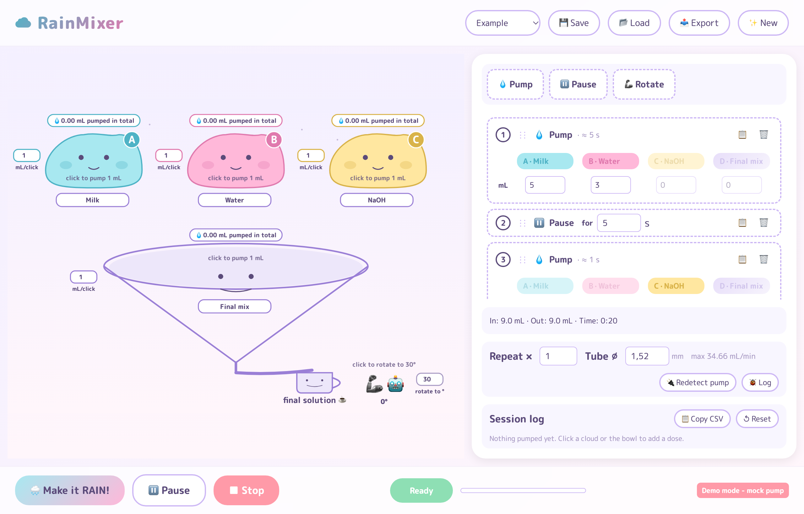
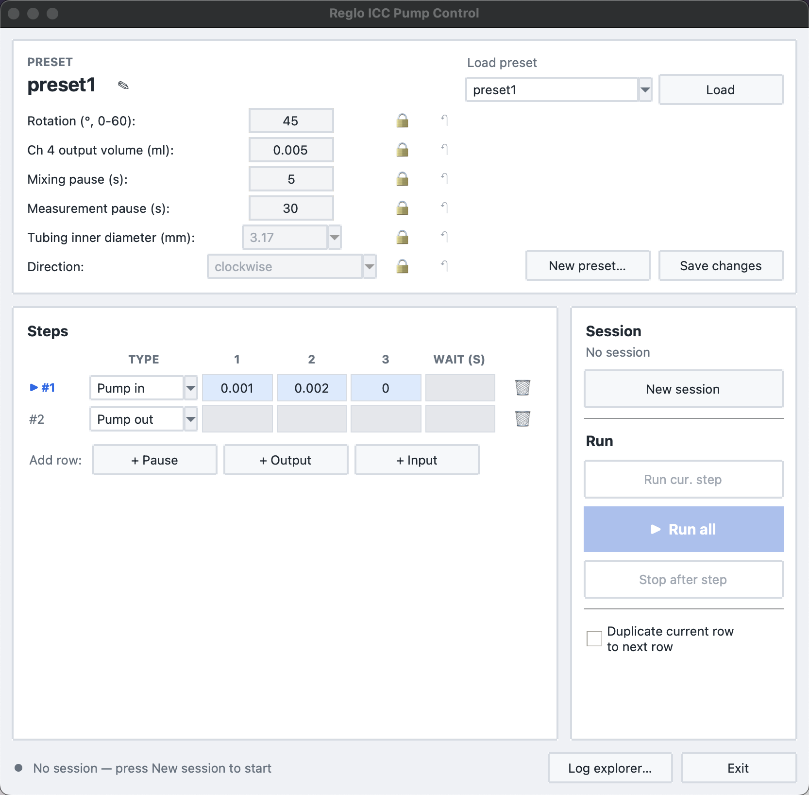

# RainMixer — Automatic Solution Mixer

<table>
  <tr>
    <td align="center" width="50%"><br><b>Kawaii GUI</b> (<code>code/src/kawaii_gui</code>)</td>
    <td align="center" width="50%"><br><b>Reglo GUI</b> (<code>code/src/reglo_gui</code>)</td>
  </tr>
</table>

An automatic solution mixer for a fluorescence scientist. A robot pumps up to
four liquids (A, B, C) into a mixing bowl (D), which is then pumped out to a
measuring instrument. The pumping is done by an Ismatec Reglo ICC peristaltic
pump, and a small robot rotates the cuvette (0–60°) for the measurement.

Built for the course Digital Fabrication and Maker Space.

## Download (Windows)

**[Download RainMixer.exe](https://github.com/fluorescence-bot/makeitpump/releases/latest/download/RainMixer.exe)**: the
latest build of `main`, rebuilt automatically on every merge. Double-click it
(Windows 10/11). Saved presets go in a `presets/` folder next to the exe. If
SmartScreen warns, choose *More info → Run anyway*.

On macOS/Linux, run from source: `code/src/kawaii_gui/run.sh`.

## Repository layout

```
code/
├── src/
│   ├── kawaii_gui/       # Main desktop GUI (pywebview + TypeScript) — start here
│   ├── reglo_gui/        # Simpler Tkinter GUI for the Reglo pump + rotator
│   └── cuvette_rotater/  # CircuitPython firmware for the cuvette rotator (Trinket M0)
└── lib/
    └── ismatec-pump/     # Python driver for the Ismatec Reglo ICC pump (GPL-3)
```

## CI

- `.github/workflows/test.yml`: Python and TypeScript tests plus the frontend build, on pushes and PRs.
- `.github/workflows/build-exe.yml`: builds `RainMixer.exe` with PyInstaller on
  every push to `main` and replaces the `latest` release with it.

## License

The project's own code is [MIT](LICENSE). The vendored pump driver in
`code/lib/ismatec-pump` is GPL-3 (see its [LICENSE](code/lib/ismatec-pump/LICENSE)),
and since `RainMixer.exe` bundles it, the exe as a whole is distributed under GPL-3.
